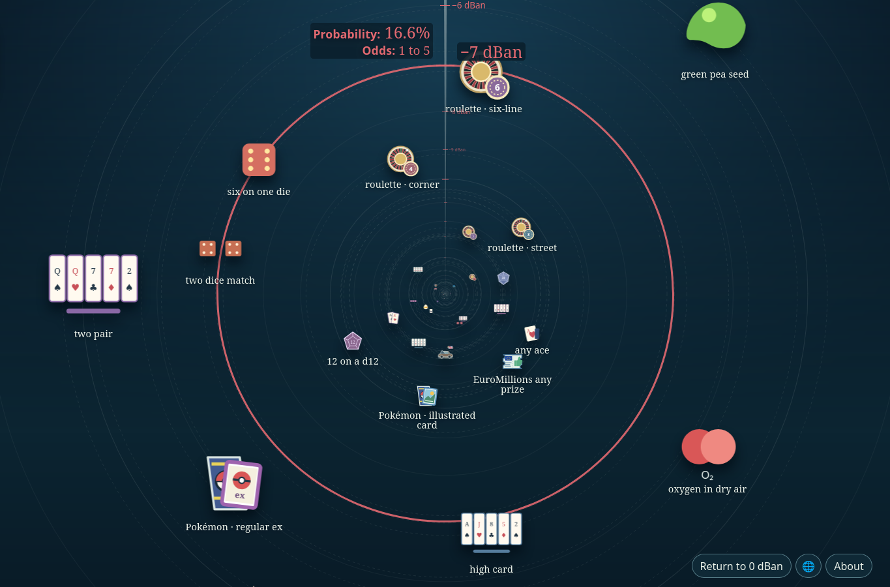

# The Scale of Probability

The Scale of Probability is an interactive atlas of probabilities expressed in decibans, odds, and percentages. It places each event at its exact depth on a continuous radial scale and provides the model, assumptions, calculations, and sources behind each example.

**[Explore the live website](https://deciban.bycelium.com)**

Use vertical mouse-wheel or trackpad input on a desktop, the Up and Down arrow keys when the scene has focus, or a one-finger vertical swipe on a touch screen.

Selecting an illustration or related example sets an exact destination and opens its details on arrival. The Return to 0 dBan control appears after the opening position.

The atlas supports English, Français, 简体中文, and Español. A localized URL selects its language. A saved language choice then takes precedence over the browser’s ordered language preferences for neutral URLs. The shared language menu is available from the opening About dialog and the globe control; its **Show all references** checkbox includes examples associated with every region instead of the selected language’s default set.

Each example has a stable URL. Use `/examples/<id>/` for the recipient’s language or `/en/examples/<id>/`, `/fr/examples/<id>/`, `/es/examples/<id>/`, or `/zh/examples/<id>/` to open a specific language. The Share icon uses the current URL and opens the native device share sheet when available. See [SEO and previews](docs/seo-and-previews.md) for static metadata and preview images, and [sharing and social GIFs](docs/sharing.md) for the sharing controls and GIF regeneration.

## Contributing

See [CONTRIBUTING.md](CONTRIBUTING.md) to correct a source or translation, add an event or language, set up the project, and run checks.

Optional production analytics require explicit visitor consent and Vercel Web Analytics. See [the analytics setup and data guide](docs/analytics.md) before enabling it for the Vercel project.

## Attribution and license

The radial scale was inspired by Cary Huang's [Scale of the Universe 2](https://www.htwins.net/scale2/), created as **carykh**. Probability models and sources are listed in the application.

Copyright 2026 Bycelium. Licensed under the [Apache License 2.0](LICENSE).
